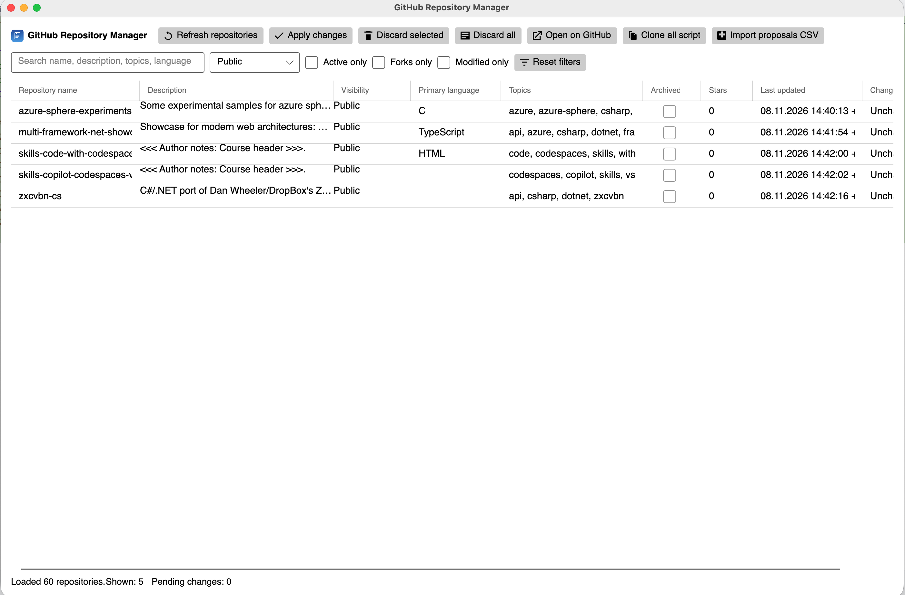
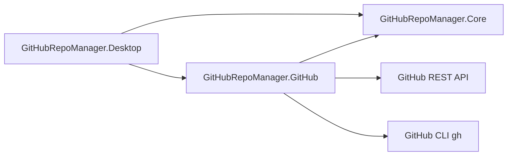

# GitHub Repository Manager

GitHub Repository Manager is a cross-platform desktop application (Avalonia + .NET 10) for loading, reviewing, editing, and applying repository metadata changes for repositories you own on GitHub.

It is designed as a production-oriented sample for modern .NET desktop architecture: MVVM, dependency injection, asynchronous workflows, clean separation between Core domain logic and GitHub API integration, and unit-testable business logic.



## Features

- GitHub CLI authentication integration (`gh auth token`) with safe process execution and timeout/cancellation support
- Repository synchronization for owned repositories with pagination and private repository support
- Editable repository properties:
  - Name
  - Description
  - Topics
  - Visibility
  - Archived state
- Search and filter UI
- Local change tracking (no immediate remote writes while editing)
- Change review dialog before applying
- Conflict detection against latest remote state before apply
- Partial success/failure handling across multi-repository apply operations
- Local JSON settings persistence (non-sensitive preferences only)
- Unit tests for validation, planning, conflict detection, change tracking, and apply behavior

## Technology Stack

- .NET 10
- C# (nullable reference types enabled)
- Avalonia UI + Avalonia DataGrid
- CommunityToolkit.Mvvm
- Octokit.NET
- Microsoft.Extensions.DependencyInjection
- Microsoft.Extensions.Hosting
- Microsoft.Extensions.Logging
- xUnit

## Architecture Overview



### Project Structure

```text
github-repo-manager/
├── src/
│   ├── GitHubRepoManager.Core/
│   │   ├── Models/
│   │   ├── Interfaces/
│   │   ├── Services/
│   │   └── Validation/
│   ├── GitHubRepoManager.GitHub/
│   │   ├── Authentication/
│   │   ├── Clients/
│   │   └── Mapping/
│   └── GitHubRepoManager.Desktop/
│       ├── Views/
│       ├── ViewModels/
│       ├── Converters/
│       ├── Styles/
│       └── Assets/
├── tests/
│   └── GitHubRepoManager.Tests/
├── README.md
└── GitHubRepoManager.slnx
```

## Prerequisites

- .NET SDK 10.0+
- GitHub CLI (`gh`) installed and available on PATH
- Authenticated GitHub CLI session:
  - `gh auth login`
  - verify with `gh auth status`

## GitHub CLI Authentication

The app uses GitHub CLI token retrieval in-process:

```bash
gh auth token
```

Behavior:

- Detects if `gh` is installed
- Handles unauthenticated/failed auth states with clear user-facing errors
- Uses process argument lists (no shell interpolation)
- Supports cancellation and process timeouts
- Does not log or persist the token

## Build and Run

```bash
dotnet restore GitHubRepoManager.slnx
dotnet build GitHubRepoManager.slnx
dotnet run --project src/GitHubRepoManager.Desktop/GitHubRepoManager.Desktop.csproj
```

## IDE Configs

The repository includes:

- `global.json` to pin .NET SDK `10.0.302`
- `.vscode/tasks.json` with `restore`, `build`, `test`, and `run-desktop` tasks
- `.vscode/launch.json` with a debug launch profile for the desktop app

## Testing

```bash
dotnet test GitHubRepoManager.slnx
```

## Security Considerations

- GitHub token is obtained from GitHub CLI and kept in-memory only
- Token is never written to app settings or plaintext files
- Sensitive operations (visibility/archive) require explicit confirmation
- Remote state is re-fetched before apply to detect conflicts
- Apply operations are non-transactional and report per-repository outcomes

## Known Limitations

- Current authentication mode is GitHub CLI only (OAuth device flow not yet implemented)
- Column visibility/width persistence is intentionally lightweight in this version
- Some advanced per-field conflict resolution UX is simplified to repository-level resolution choices
- Upstream transitive dependency audit warning for `Tmds.DBus.Protocol` may appear via Avalonia on some environments
